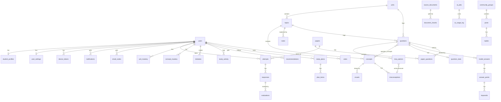

# Database

PostgreSQL 15 + the `pgvector` extension. Models live in `shared/db/models/` (one file per
area), enums in `shared/enums.py`, migrations in `migrations/versions/`.
Schema owner: **Keshomigha**. Each module owner owns the logic that uses their tables.

```
alembic upgrade head                              # create / update every table
python scripts/seed_dev.py --with-samples         # syllabus, groups, settings, 15 sample MCQs
docker compose exec api python -m scripts.seed_dev --with-samples    # same, inside Docker
```

Migrations, in order: `0001_initial_schema` -> `0002_onboarding_auth` -> `0003_full_schema`.
53 app tables (54 with Alembic's own `alembic_version`).

---

## 1. Conventions

| Topic | Rule |
|---|---|
| Primary keys | `id UUID` from `UUIDPrimaryKeyMixin` (`gen_random_uuid()`). A few 1:1 / key tables use another key: `user_settings.user_id`, `app_config.key`, `question_concepts (question_id, concept_id)`. |
| Timestamps | `created_at`, `updated_at` from `TimestampMixin`: `timestamptz`, stored in UTC. Dates without a time (plan dates, activity dates) are `DATE` in the student's local (Sri Lanka) date. |
| Names | Tables plural `snake_case`; foreign keys `<thing>_id`. Constraint names come from the naming convention in `shared/db/base.py` (`ix_`, `uq_`, `ck_`, `fk_`, `pk_`), so migrations are stable. |
| Enums | Python `StrEnum` stored as `VARCHAR(32)` **+ a CHECK constraint** (`str_enum()` in `shared/db/base.py`). The CHECK is named `ck_<table>_<enum_name>`, e.g. `ck_users_user_role`. A few older string columns (e.g. `papers.paper_type`, `attempts.status`) have a hand-written CHECK instead. |
| Embeddings | `vector(768)` + `embedding_model VARCHAR(64)` next to it, with an **HNSW cosine index** (`USING hnsw (embedding vector_cosine_ops)`): `concepts`, `questions`, `answer_points`, `document_chunks`. |
| AI output | Rows written by the AI have `model`, `prompt_version` and `job_id` (FK `ai_jobs`, SET NULL) - `AIGeneratedMixin` - so outputs can be compared when a prompt changes. |
| JSON / arrays | `JSONB` with `'{}'` / `'[]'` defaults; arrays `ARRAY(TEXT)` / `ARRAY(UUID)` with `'{}'`. |
| Indexes | Every foreign-key column has an index (Postgres does not add them by itself). |

### Delete rules

| When you delete... | ...this happens |
|---|---|
| a **user** | Their private data is deleted (CASCADE): profile, settings, codes, reset tokens, device tokens, notifications, attempts + responses, uploads + summaries, library, mastery, mistakes, recommendations, plans, votes, group memberships. |
| | Shared content they wrote is **kept, with the author set to NULL**: questions, notes, visuals, posts, replies, and review decisions (`reviewed_by`, `verified_by`, `resolved_by`, `approved_by`...). |
| a **unit / topic / concept** | Cascades only down the syllabus tree (unit -> topics -> concepts). Content that points at a topic/concept uses **RESTRICT** (notes, visuals, questions, misconceptions, question_concepts), so the delete fails. **Set `is_outdated = true` instead of deleting.** |
| a parent row | Child rows go with it: options, answer points, keywords, chunks, paper questions, replies, votes. |

---

## 2. Tables per module

### `user.py` - Mogith (auth, profiles)
| Table | Purpose |
|---|---|
| `users` | One row per Firebase account. `display_name` = the API's `full_name`. Unique `lower(email)`, E.164 `phone` CHECK, `role` index. |
| `student_profiles` | Onboarding answers: stream, subject, target grade (`A`/`B`/`C`/`S`), confidence (0-100), study days, hours per day, preferred time, `profile_completed_at`, `diagnostic_completed_at`, `diagnostic_skipped_at`. |
| `user_settings` | Theme, notifications on/off, daily reminder time, email updates. Key = `user_id`. |
| `device_tokens` | FCM push tokens (one per phone / browser). |
| `notifications` | In-app notifications; partial index on unread ones. |

### `auth.py` - Mogith (auth)
| Table | Purpose |
|---|---|
| `email_codes` | 6-digit codes (HMAC hash only) for verify-email and reset-password. |
| `password_reset_tokens` | Single-use token after a correct reset code (hash only). |

### `syllabus.py` - Keshomigha
| Table | Purpose |
|---|---|
| `units` | The 10 units. `number` (1-10) is the code and the display order; `exam_weight` = past-paper weight. |
| `topics` | Topics in a unit, `number` like `"6.2"`. |
| `concepts` | Ideas inside a topic, `code` like `"6.2.1"`, with an embedding. |

### `content.py` - Samni
| Table | Purpose |
|---|---|
| `notes` | Full / short topic notes. One approved topic note per (topic, kind) (partial unique index). |
| `uploads` | Files students upload (max 20 MB, CHECK). |
| `summaries` | AI summaries of uploads (key points, key terms). |
| `library_items` | A student's saved items - **polymorphic, see section 4**. |

### `visual.py` - Mogith
| Table | Purpose |
|---|---|
| `visuals` | Mermaid diagrams and AI illustrations, with verification and safety flags. |
| `visual_reports` | Students report wrong / unclear visuals. |

### `question.py` - Udith
| Table | Purpose |
|---|---|
| `questions` | The question bank (`source` = origin: past_paper / ai / admin / manual). Past papers unique by (year, part, number). |
| `mcq_options` | Options `A`-`E`; **at most one correct** (partial unique index). |
| `misconceptions` | Common wrong ideas, linked from wrong options. |
| `question_concepts` | Which concepts a question tests (with a weight). |

### `quality.py` - Udith
| Table | Purpose |
|---|---|
| `question_reviews` | AI / admin reviews (verdict, checks, score). |
| `question_reports` | Student reports; partial index on unhandled ones. |
| `question_stats` | Times answered / correct; `correct_rate` is **computed by Postgres**. |

### `exam.py` - Udith (exams), Mogith (diagnostic)
| Table | Purpose |
|---|---|
| `papers` | Quizzes, diagnostics, past / model papers, AI practice papers (`paper_type`). |
| `paper_questions` | Questions in a paper, in order; a question appears once per paper. |
| `attempts` | One try of a paper. `kind` (diagnostic / quiz / exam / practice); **only one unfinished diagnostic per student**. |
| `responses` | One answer per question per attempt (unique). |

### `knowledge.py` / `evaluation.py` - Keshomigha
| Table | Purpose |
|---|---|
| `model_answers` | Model answers of structured / essay questions. |
| `answer_points` | Marking points (with embeddings for semantic marking). |
| `keywords` | Keywords + synonyms per point (unique per point, case-insensitive). |
| `evaluations` | AI marking of a written answer: keyword / semantic scores, confidence, plus a teacher's manual marks for the accuracy report. |

### `performance.py` - Keshomigha (home: Mogith)
| Table | Purpose |
|---|---|
| `mistakes` | Each mistake + its type; partial index on unresolved ones. |
| `concept_mastery` | Mastery 0-1 per student per concept. |
| `unit_mastery` | **History** of unit mastery (0-100): every diagnostic/quiz adds rows. Current = newest row per unit. |
| `mastery_snapshots` | Overall mastery (0-100) per student per day, for weekly progress. |
| `study_activity` | One row per student per study day (streak), with minutes and actions. |

### `recommendation.py` - Udith (daily plan: Mogith)
| Table | Purpose |
|---|---|
| `resources` | YouTube videos, articles, internal notes; unique per (provider, external_id). |
| `recommendations` | Next steps for a student (action type, priority 1-5, status). |
| `study_plans` | Multi-day plans; **only one active plan per student**. |
| `plan_items` | Tasks of a plan. |
| `daily_plan_items` | "Today's plan" on the home screen. |

### `community.py` - Keshomigha (backend), Samni (mobile)
| Table | Purpose |
|---|---|
| `community_groups` | "General" (default) + one group per unit (`slug`). |
| `group_members` | Membership + role. |
| `posts` | Questions / discussions; kept with `author_id = NULL` if the author leaves. `accepted_reply_id` is a circular FK to `replies`. |
| `replies` | Answers (students or AI, with RAG `sources`). |
| `votes` | +1 / -1 on exactly one post **or** reply (CHECKs). |
| `content_reports` | Reports on posts / replies - polymorphic `target_type` + `target_id`. |

### `rag.py` - Keshomigha (schema), Samni (RAG)
| Table | Purpose |
|---|---|
| `source_documents` | Admin-approved documents ingested for RAG. |
| `document_chunks` | Searchable chunks: `embedding` (HNSW) for meaning search + `tsv` (generated `tsvector`, GIN) for keyword search. |

### `system.py` - shared
| Table | Purpose |
|---|---|
| `ai_jobs` | Long-running AI jobs (the app polls them). |
| `ai_usage_log` | Every AI call: tokens, images, cost, latency, user. |
| `audit_log` | Admin actions with before / after. |
| `app_config` | App-wide settings as JSON: `AL_EXAM_DATES`, `DAILY_LIMITS`... |

---

## 3. Main relations



---

## 4. Polymorphic references (no foreign key)

| Column | Points to | Why no FK |
|---|---|---|
| `library_items.item_id` | notes / summaries / visuals / questions / resources / posts, chosen by `item_type` | One FK column cannot point at six tables. |
| `content_reports.target_id` | posts or replies, chosen by `target_type` | Same reason. |

Rules for code using them: check that the item exists before saving, and expect items that
were deleted later (show "this item is no longer available" instead of crashing).
`item_type` / `target_type` have CHECK constraints, so only known kinds can be stored.

---

## 5. Changing the schema safely

1. **Never edit a migration that is merged into `develop`** - teammates have already applied it.
2. Change the model in `shared/db/models/` (new model? also import it in `__init__.py`).
3. `alembic revision --autogenerate -m "short description"` - a **draft** only.
4. Read and fix the file. Autogenerate does **not** add: CHECK constraints (including enum
   CHECKs), data fixes for existing rows, and it sometimes misses expression indexes.
5. New columns on existing tables must be `nullable` or have a `server_default`.
   Rename with `op.alter_column(..., new_column_name=...)`, never drop + add.
6. Write a working `downgrade()`.
7. `alembic upgrade head`, `alembic downgrade -1`, `alembic upgrade head`, then
   `pytest tests/db` (it checks that models and migrations still match).
8. Update this file.

### Adding an enum value
The CHECK constraint lists the allowed values, so a new value needs a migration:
```python
op.drop_constraint("ck_attempts_attempt_kind", "attempts", type_="check")
op.create_check_constraint(
    "ck_attempts_attempt_kind", "attempts", "kind IN ('diagnostic', 'quiz', 'exam', 'practice', 'new')"
)
```
Do this for every table that uses the enum (`grep str_enum(TheEnum)`). Never remove or rename a
value that may already be stored. `JobType` values also need an ai_service pipeline (a test checks).

---

## 6. Firebase Storage layout

Only paths are stored in the database; files live in Firebase Storage.

| Path | Column | Status |
|---|---|---|
| `uploads/{user_id}/{upload_id}.pdf` | `uploads.file_path` | used now (content module) |
| `uploads/{user_id}/notes/{upload_id}.{ext}` | `uploads.file_path` | planned layout for new upload types |
| `answers/{user_id}/{response_id}/page-{n}.jpg` | `responses.image_paths` | planned (evaluation) |
| `visuals/{concept_id}/{visual_id}.png` | `visuals.image_path` | planned (visuals) |
| `posts/{post_id}/{n}.jpg` | `posts.image_paths` | planned (community) |
| project-relative path, e.g. `data/rag_sources/unit_06.pdf` | `source_documents.file_path` | used now (RAG ingestion) |

In dev without a bucket, the same paths are used under `LOCAL_STORAGE_DIR`.

---

## 7. Names that differ from the original spec

The code was already using these names, so they were kept (the spec name is in a comment):

| Spec | Kept |
|---|---|
| `users.full_name` | `users.display_name` |
| `units.code` / `order_index`, `past_paper_weight` | `units.number`, `exam_weight` |
| `topics.code` | `topics.number` |
| `concepts.title` | `concepts.name` |
| `notes.kind`, `notes.sources` | `notes.note_type`, `notes.citations` |
| `questions.type`, `stem_md`, `explanation_md`, `origin` | `question_type`, `stem`, `explanation`, `source` |
| `mcq_options.label` 1-5 (SMALLINT), `text_md` | `label` `"A"`-`"E"`, `text` |
| `papers.kind`, `time_limit_minutes` | `paper_type`, `duration_minutes` |
| `paper_questions.order_index` | `position` |
| `model_answers.answer_md` | `answer_text` |
| `evaluations.points_covered`, `feedback_md` | `matched_points`, `feedback` |
| `question_stats.times_answered` / `times_correct` | `attempts_count` / `correct_count` |
| `unit_mastery` 0-1, one row per unit | 0-100, a **history** (newest row = current) |
| `plan_items.scheduled_date`, `plan_id` | `due_date`, `study_plan_id` |
| `daily_plan_items.order_index`, `estimated_minutes` | `position`, `minutes` |
| `posts.body_md`, `replies.body_md`, `is_ai_answer` | `body`, `is_ai_suggested` |
| `ai_jobs.type`, `result_ref` | `job_type`, `result` |
| `ai_usage_log.feature` | `operation` |
| `audit_log.entity_type` / `entity_id` | `target_type` / `target_id` |
